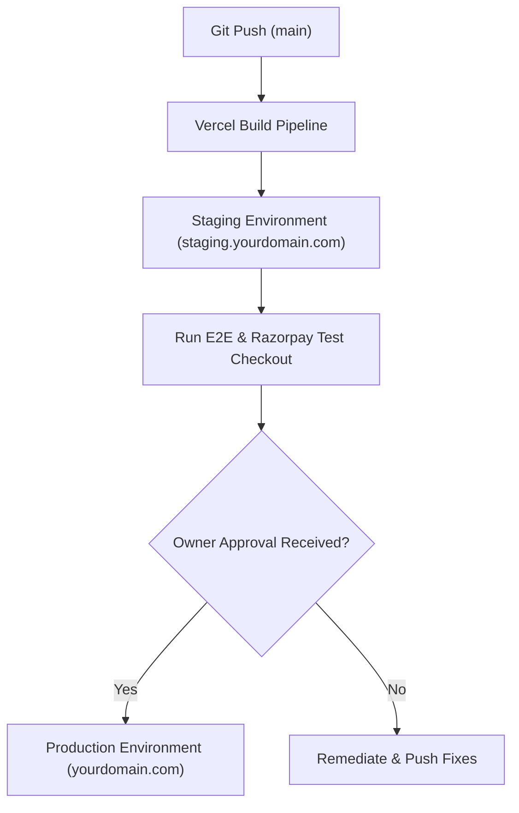

# Sanctuary Residences — Production & Staging Deployment Guide

A reproducible step-by-step technical guide for deploying Sanctuary Residences to **Vercel** with a custom domain, separated staging/production environments, Supabase database migrations, Razorpay live checkout, and transactional email.

---

## 1. Hosting Architecture & Prerequisites

### Commercial Licensing Prerequisite
- **Platform**: Vercel
- **Required Plan**: **Vercel Pro** team account ($20/month per seat).
- *Compliance Note*: The Vercel Hobby plan strictly prohibits commercial transactional use. Coworking spaces and membership residencies require Vercel Pro.

### Client-Owned Accounts Required
1. **GitHub Repository**: `https://github.com/MJ636UoW/Study_place.git` (connected to Vercel).
2. **Vercel Team Account**: With Pro subscription.
3. **Supabase Accounts**: Two distinct projects (`sanctuary-staging` and `sanctuary-production`).
4. **Razorpay Merchant Dashboard**: Verified business KYC with live API key activation.
5. **Transactional Email**: Resend or Amazon SES with domain DNS ownership.
6. **DNS Registrar**: Access to DNS zone records (Cloudflare, GoDaddy, Namecheap, Route53, etc.).

---

## 2. Staging-First Deployment Sequence

Before promoting to the live production domain or processing real financial transactions, deploy and verify the **Staging** environment.



### Step 1: Connect Git to Vercel
1. Log in to Vercel Pro Dashboard.
2. Select **Add New...** ➔ **Project**.
3. Import `MJ636UoW/Study_place`.
4. Configure Framework Preset: **Next.js**.
5. Set Root Directory: `./`.

### Step 2: Configure Staging Environment Variables
Under Vercel **Settings ➔ Environment Variables**, assign variables scoped strictly to **Preview** and **Development** (see [`ENV_CHECKLIST.md`](./ENV_CHECKLIST.md)).
- Set `NEXT_PUBLIC_APP_URL` to your staging domain or Vercel generated preview URL.
- Use `rzp_test_...` credentials for Razorpay.
- Use the staging Supabase project credentials.

### Step 3: Run Database Migrations on Staging
In your staging Supabase project SQL Editor, execute migrations in order:
1. `supabase/migrations/20261025000001_initial_schema.sql`
2. `supabase/migrations/20261025000002_rls_policies.sql`
3. `supabase/migrations/20261025000003_seed_structural_data.sql` (structural seats and plans only; zero demo users)
4. `supabase/migrations/20261025000004_booking_engine_functions.sql`
5. `supabase/migrations/20261025000005_payment_refund_lifecycle.sql`
6. `supabase/migrations/20261025000006_first_admin_setup.sql`

### Step 4: Verify Staging Functionality
- Verify workstation floorplan loads at `/book`.
- Submit hold request; confirm 15-minute countdown established.
- Perform test payment in Razorpay TEST mode; confirm server-side HMAC-SHA256 signature verification and pass issuance.
- Access `/admin` and confirm redirect to `/admin/mfa`.

---

## 3. Production Deployment & Custom Domain Setup

Once staging is verified and client sign-off is granted, execute the production rollout.

### Step 1: Custom Domain & DNS Configuration
In Vercel **Settings ➔ Domains**, add your custom apex domain (e.g. `yourdomain.com`) and `www` subdomain (`www.yourdomain.com`).

Configure the following DNS records with your registrar:

| Type | Name / Host | Target / Value | TTL | Purpose |
| :--- | :--- | :--- | :--- | :--- |
| **A** | `@` (apex) | `76.76.21.21` | Auto / 300 | Vercel Anycast IP |
| **CNAME** | `www` | `cname.vercel-dns.com.` | Auto / 300 | Canonical WWW Routing |
| **CNAME** | `staging` | `cname.vercel-dns.com.` | Auto / 300 | Staging Subdomain |

*Vercel will automatically provision and renew a Let's Encrypt TLS/SSL certificate.*

### Step 2: Transactional Email DNS Records (Resend / Provider)
Add the SPF, DKIM, and DMARC TXT records provided by your email provider:

| Type | Name / Host | Value | Purpose |
| :--- | :--- | :--- | :--- |
| **TXT** | `@` | `v=spf1 include:amazonses.com ~all` (or provider value) | SPF Sender Validation |
| **CNAME** | `resend._domainkey` | `dkim.resend.com.` | DKIM Cryptographic Signature |
| **TXT** | `_dmarc` | `v=DMARC1; p=reject; rua=mailto:dmarc@yourdomain.com` | DMARC Anti-Spoofing Policy |

### Step 3: Production Database Migrations
In the separate **Production** Supabase project, execute migrations `000001` through `000006`.
- **Zero demo records**: Production database starts completely clean with structural locations, seat layouts, and plan rates.

### Step 4: Initial Superadmin Onboarding
1. Have the principal owner sign up with their official email via the live site (`/login`).
2. Run the secure setup procedure in the production Supabase SQL Editor:
   ```sql
   SELECT provision_initial_superadmin('owner@yourdomain.com', 'Production Launch Sign-Off');
   ```
3. Have the owner log into `/admin`, proceed to `/admin/mfa`, and enroll their authenticator app (Google Authenticator, 1Password, or Authy).

### Step 5: Razorpay Live Key Activation & Webhook Setup
1. Switch Razorpay Dashboard to **Live Mode**.
2. Generate Live API Keys (`rzp_live_...`).
3. Under **Settings ➔ Webhooks**, add a webhook with URL:
   `https://yourdomain.com/api/webhooks/razorpay`
4. Set Webhook Secret (`whsec_live_...`) and save in Vercel Production Environment Variables.
5. Subscribe to required events:
   - `payment.captured`
   - `payment.failed`
   - `refund.processed`
   - `refund.failed`

### Step 6: Bind Vercel Cron Secret
Generate a high-entropy 64-character token:
```bash
node -e "console.log(require('crypto').randomBytes(32).toString('hex'))"
```
Set `CRON_SECRET` in Vercel Production Environment Variables. Vercel Cron automatically attaches this token as `Authorization: Bearer <CRON_SECRET>` when invoking background jobs.
